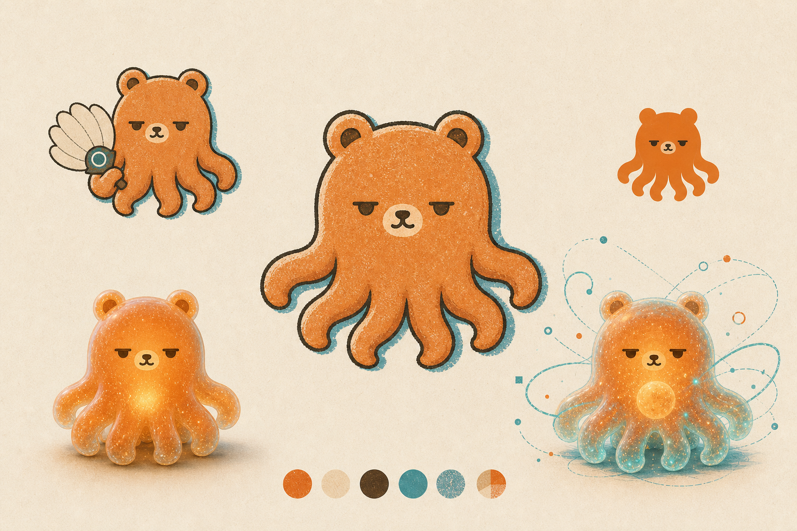
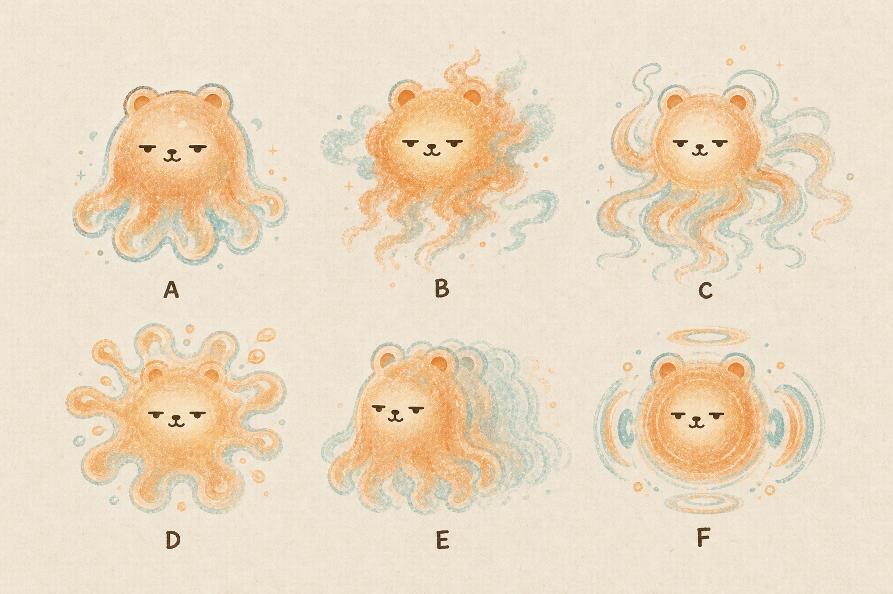
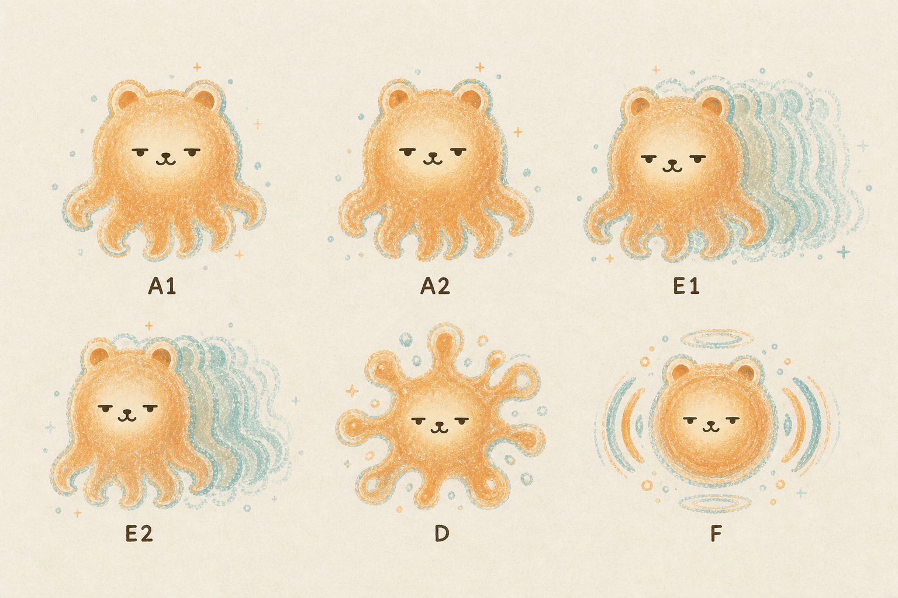
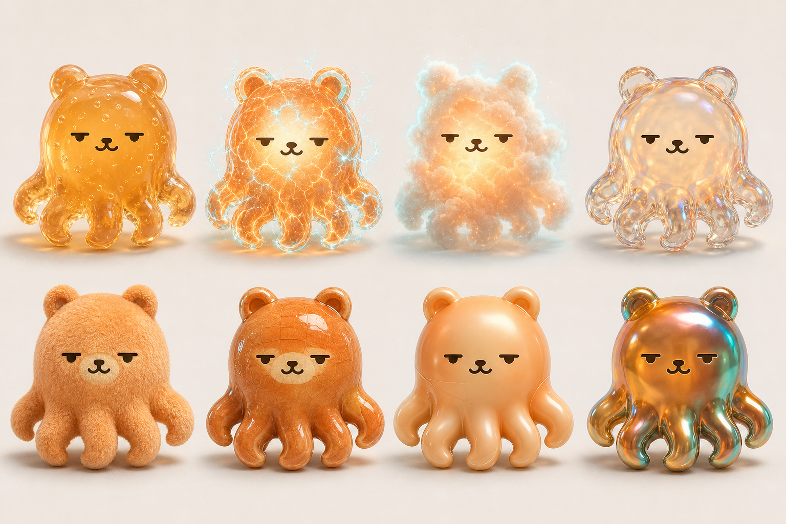
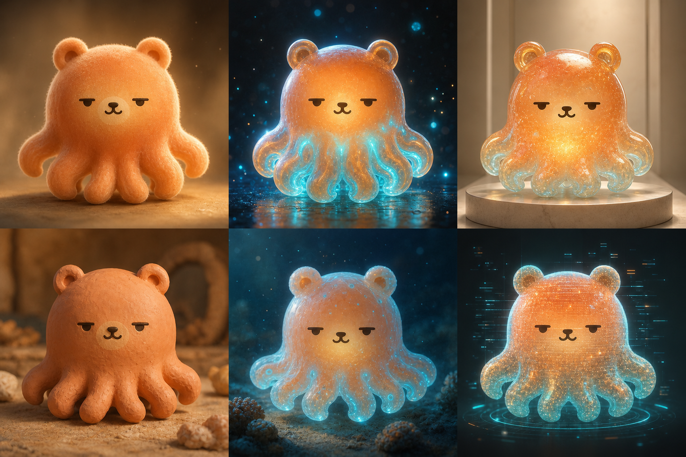

# Obo / 啵啵：AI 作图形象参考

这是啵啵的公开形象参考包。**先看经典形体，再按本次作图要求选择材质。** 本库只提供角色参考，具体主题、动作、场景、构图仍由用户随后指定。

## 1. 标准形体与身份

- 一颗圆润的一体式头身，两只自然长出的小熊耳；没有脖子、胸腹、腰或独立躯干。
- 半眯眼、小鼻口、奶油色口鼻区；冷静、松弛、聪明，略有冷幽默。
- 暖柿橙主体，青绿作为后侧、底部、连接或残影提示。
- 设定为 **9 条厚软腿，正面通常看见 5 条，后面 4 条由遮挡、后侧轮廓或能量残影暗示**。无需摊开数清九条。
- 避免变成普通熊、机器人、章鱼怪；不要添加吸盘、细触手或独立人形身体。
- 默认空手；参考板中的扇子不是固定身体部件。

下图是经典形体对照：中央锁定基本角色，左下为半透明果冻能量体，右下为内部核心与连接能量状态。生成探索图的腿数并不都精确，不能据此改写九腿设定。

[打开经典形体原图](https://raw.githubusercontent.com/76776198xiong-stack/bobo-reference/main/images/01-classic-identity.png)

## 2. 过去明确喜欢的能量体方向

根据 2026-06-09 设计档案的偏好记录：**用户喜欢 A 和 E；C 可以接受；D / F 保留为特殊状态；B 淘汰。** 这是历史偏好记录，不代表用户已经从所有三维材质中选定了唯一最终版本。

- **A（左上）**：稳定、柔和、半透明的基础存在形态。
- **E（下中）**：保持主体轮廓，以青绿重叠残影表达并行、多线程和开挂。
- C（右上）是流动候选；D（左下）是爆发态；F（右下）是核心或启动态。

后续细化板：**A1 左上、A2 上中、E1 右上、E2 左下**。A1/A2 属于稳定形态，E1/E2 属于并行残影形态。未找到在这四格之间唯一选定的记录，因此保留原板，不擅自裁成唯一首选。

[打开能量体细化原图](https://raw.githubusercontent.com/76776198xiong-stack/bobo-reference/main/images/03-energy-refined-a1-a2-e1-e2.png)

## 3. 各种三维材质

下面八种材质从左到右、从上到下依次为：

| 上排 | 琥珀果冻 | 等离子能量 | 云光精灵 | 吹制玻璃 |
|---|---|---|---|---|
| 下排 | 短绒毛绒 | 釉面陶瓷 | 珠光软胶 | 液态金属 |

**上排第二格是等离子能量材质，但没有证据表明它是唯一获用户认可的能量版。** 使用时不要把电弧和密集裂纹当成所有能量体的必备特征。

## 4. 三维渲染体系参考

从左到右、从上到下：电影级风格化 3D、游戏 PBR 能量生物、透明树脂艺术潮玩、定格黏土、生物荧光海洋精灵、全息数字伴生体。

上排中间适合参考“暖橙半透明主体 + 内部柔光核心 + 青绿能量流”的组合。它是可用的三维参考方向，不是新宣布的唯一标准材质。

## 5. 可以直接发给 ChatGPT 的说明

> 请读取本页并实际查看图片，先锁定啵啵的经典形体：一体式圆润头身、小熊耳、半眯眼、小鼻口、暖柿橙和青绿提示，九条厚软腿（正面通常五条，后四条由遮挡暗示）。能量体优先参考第二节历史明确喜欢的 A / E 家族；三维材质按我随后给出的任务选择，不要把孔版纸张质感、电弧或果冻设为所有图片的必需条件。参考板用于锁定角色，不用于照搬拼版构图。先等我的具体作图指令。若你无法实际看到图片，请明确说明。

如果网页端只读到文字、没有实际看到图片，请下载本页对应原图，再作为图片附件上传到作图对话。公开链接已可提供访问，但不能保证每个 ChatGPT 会话都能通过链接直接载入图片作为视觉参考。

## 来源与状态

原图来自 2026 年 6 月的啵啵 IP 设计探索，保持原文件像素不变。形体依据后续九腿规则；A/E 偏好依据原设计档案；2026-07-13 后续配图基线允许三维材质随场景变化。本库是外部分享用快照，未改变本地规则原件。

[原图文件与校验值](SOURCES.md)

未授予本仓库内容开放许可。

## 更新记录

- 2026-10-30：整理经典形体、历史获偏好的能量形态及三维材质原图，用于用户在 Codex 与网页版 ChatGPT 之间共享作图参考。
