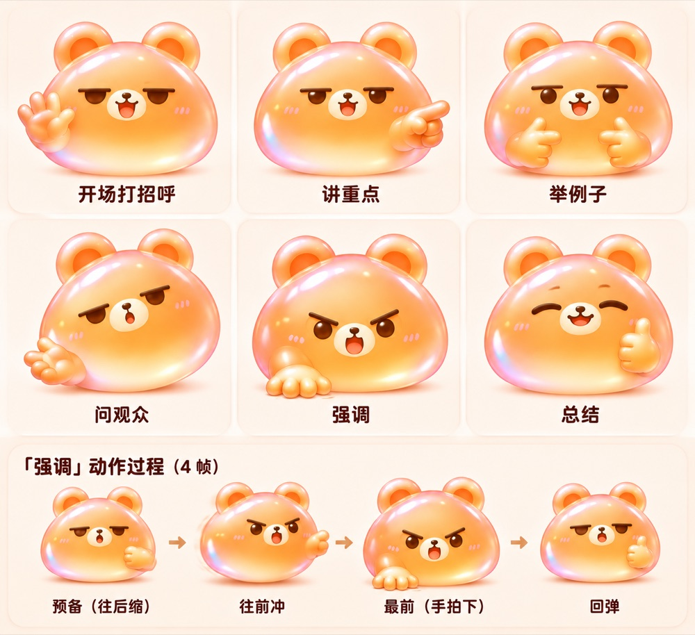
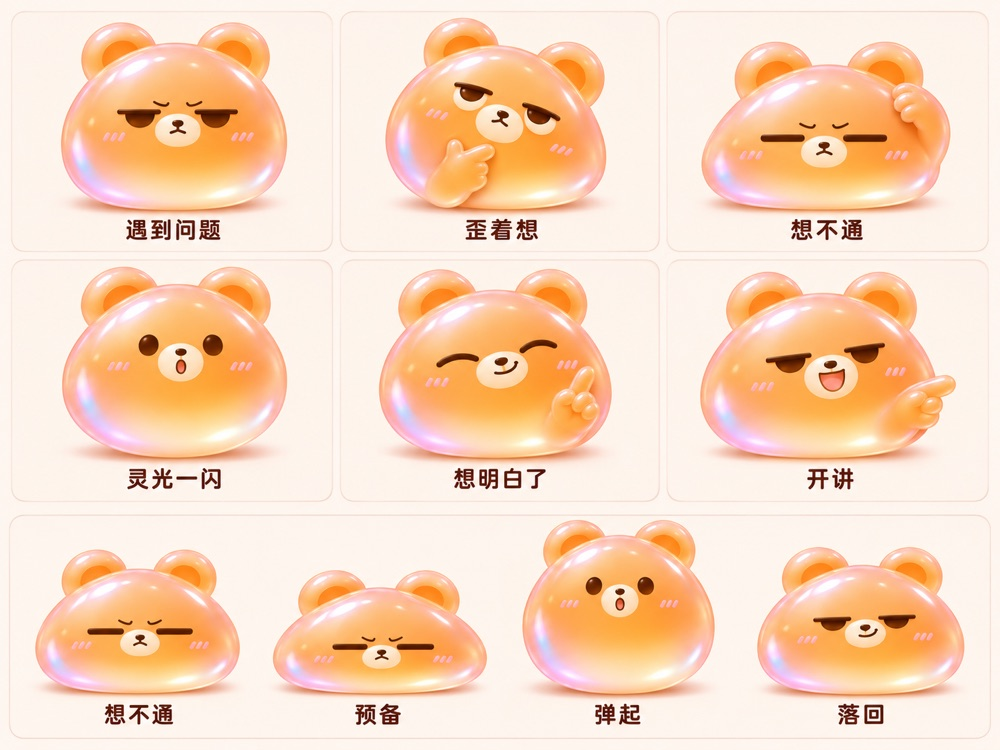
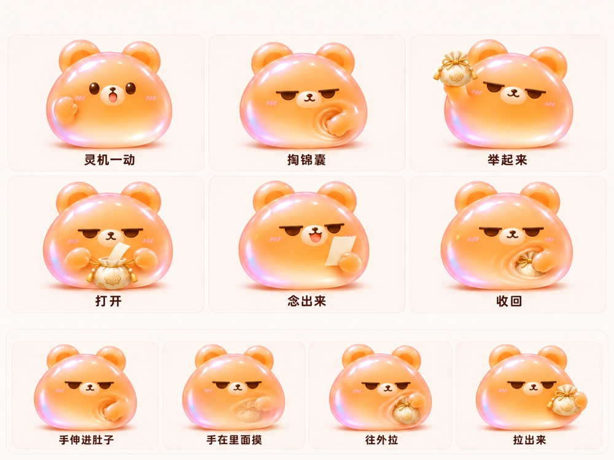
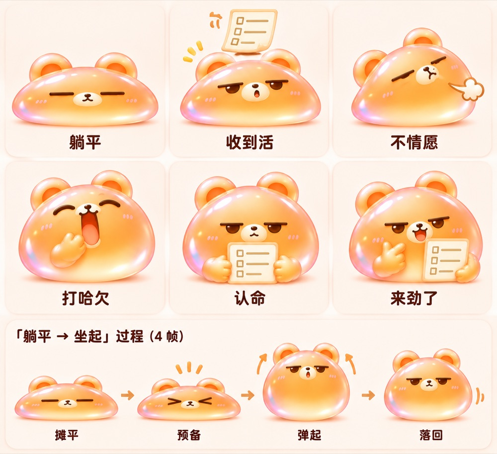
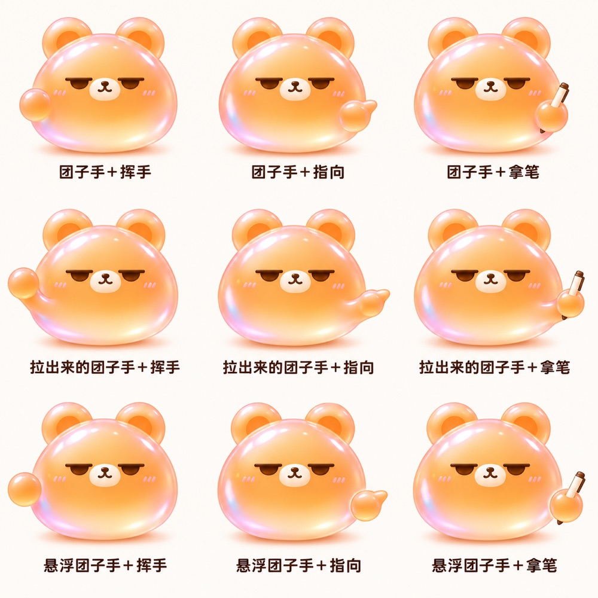
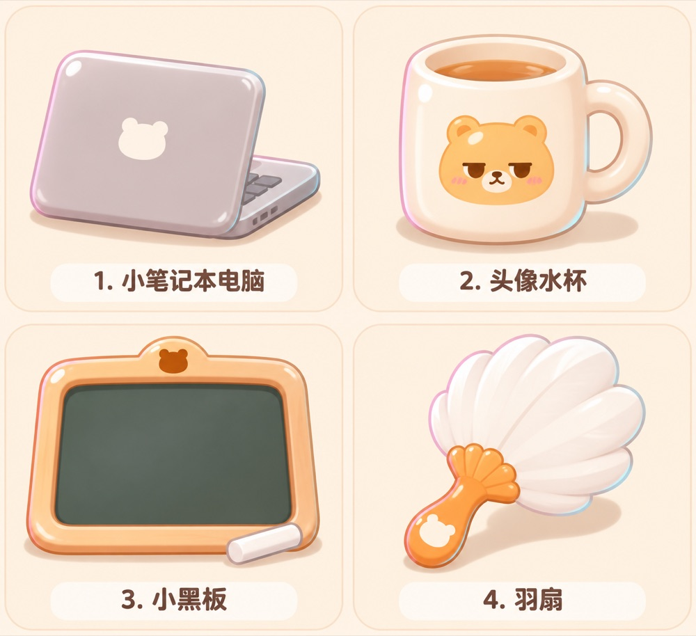
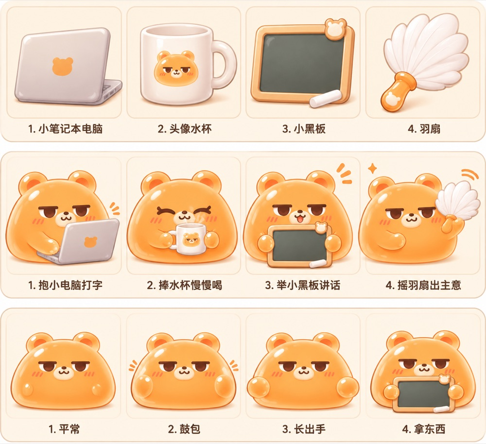
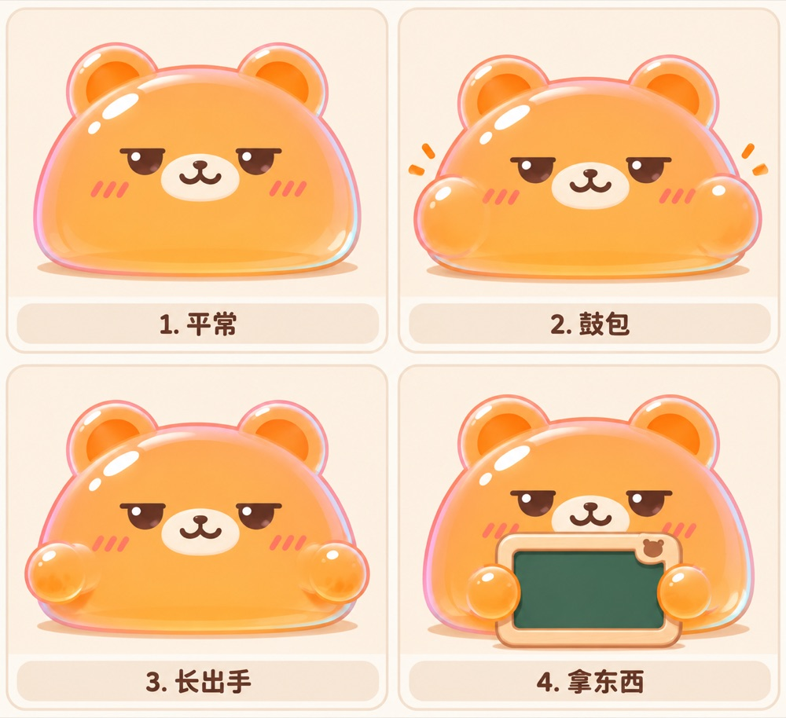
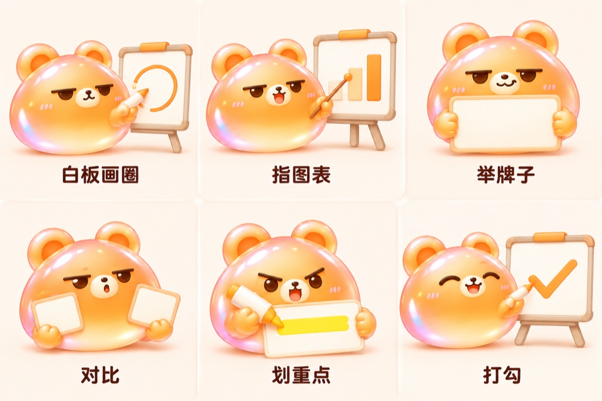

<!--
明镜协议: 明镜铭牌/v0.2
标识: bobo-public-f64d408f37
对象类型: 文档
正式归属: 啵啵
内容类型: 导航
主题: 啵啵
用途: 内部执行、口径核对
场景: 聊到啵啵
事实角色: 当前事实
处理状态: 已确认
审查状态: AI 已初审
依据资格: 可作为依据（仅明确作者决定；建议及待定项不据此升级）
生命周期: 生效中
来源: 作者2026-11-16本次决定及十一月啵啵/自媒体商业系统/软件资料
建立时间: 2026-11-16
更新时间: 2026-11-16
入口: 素材图鉴.md
-->

# 动作、表情与道具图鉴

本页精选11张预览；全部25项见[完整素材图鉴](完整素材图鉴.md)。它们按用途分开，不宣称都是最终生产素材。完整本地盘点另有25项版本；本页公开与协作最相关的部分。

## B-SPEECH-001

系列曾认可；图中有旧手指，后续只参考表情、讲解动作；手按11-04腮帮子团子手重做。

状态：作者认可可用-不逐格重改

## B-THINK-001

作者认可系列；仅参考副本，原图待补；不继承图中的旧手型。

状态：作者认可系列；仅参考副本，原图待补

## B-POUCH-001

锦囊设计和最终手型未定，参考副本不是完整生产资产。

状态：已登记候选参考；原图待补；锦囊外观与最终手型待裁决

## B-WORK-001

情绪和形变参考；旧手型保留历史，原图待补。

状态：已登记系列参考；旧手型保留不重画；原图待补

## B-HAND-DESIGN-001

团子手形态参考；图中从身体两侧出手的动作已被11-04腮帮子出手覆盖。

状态：当前团子手规则参考；近身采用第2行，可断开悬浮；原图待补

## B-PROP-001

道具参考；单独透明道具及生产可用性未验收。

状态：作者认可-11-03

## B-PROPHOLD-001

11-04作者反馈脸不像，只参考道具与动作，脸以母版为准。

状态：作者认可-11-03

## B-HANDKEY-001

腮帮子鼓包出手被作者留下；图中脸不像，不能当新母版。

状态：作者认可-11-03

## B-TEACH-001

候选待审，不能因有文件就直接发布。

状态：候选素材-待作者审核

## B-MASTER-001

原母版保留；当前首页按作者11-16选择高光版。

状态：原母版历史对照

## B-MASTER-001-EYE-v1

修订版与原件分别保留；主页采用不等于整批动作验收。

状态：主页采用高光版（作者11-16定）

原件保留本地；此处JPEG仅等比缩小，未裁切、未重绘。校验见[图片清单](images/manifest.json)。
