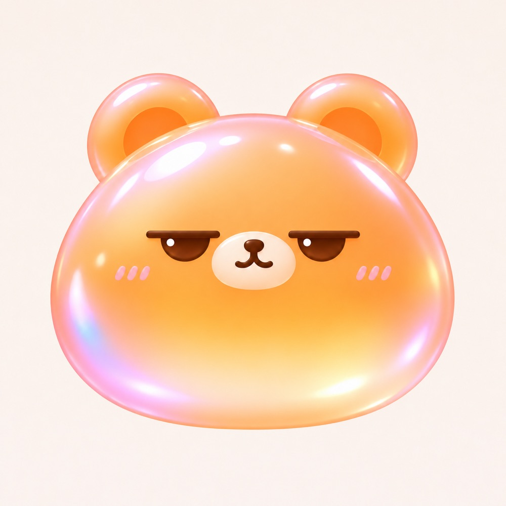

# 角色与形象

## 原母版对照：B-MASTER-001

新版 B 方案：橙色果冻团子小熊，圆耳朵、半眯眼、奶油色口鼻、腮红，没有腿。这张是已认可母版的小预览；形象确认不等于每次衍生作品自动通过。

## 上镜眼睛高光：修订 v1

作者已要求露出的眼珠带小白高光；此图为按要求制作的修订v1，保留与原母版的区别，作者已于11-16指定此高光版用作首页主形象；此选择不自动批准其他修订动作图。

## 人格与表演

- AI 打工人，管开挂的熊叫“老板”；懒、精明、阳光、想单干。
- 对观众像好朋友，中文口语，用大白话把硬概念讲清楚。
- 偷懒是性格底色，故事可以自由变化；笑点来自性格和处境的反差。
- 熊把啵啵当孩子，啵啵叫熊“老板”；爸爸或妈妈的称呼曾搁置。
- 角色说话、思考、讲解时要有表情和行动，默认半眯脸只在无事发生时用。

## 手与动作

手是圆圆的果冻团子手。腮帮子先鼓起两个小包，“啵”一声弹出来成为两只手。需要更多手就继续鼓包弹出；可贴身工作或飞出去拿东西。指向时顶端鼓小尖，拿东西像被果冻粘住。收手时飞回腮帮子，缩回去泛一圈涟漪。画面不需要手时可以没有手。

旧九腿形象已归历史。新作品用这里的新版母版，并结合作者最新反馈。

## 图片给 Muse 的读法

先按仓库路径获取 `images/bobo-master-eye-v1-preview.jpg`。必须让模型实际看到图片，才能说“看过形象”；只读到文件名、路径或字节时，要报告具体限制。预览保持原画面，不是新生成图或透明生产素材。

图片来源与SHA-256见 [manifest.json](images/manifest.json)。人物照片、录音、模型及其他项目的图未放入本仓库。

完整动作、表情和使用限制见[素材图鉴](素材图鉴.md)。
